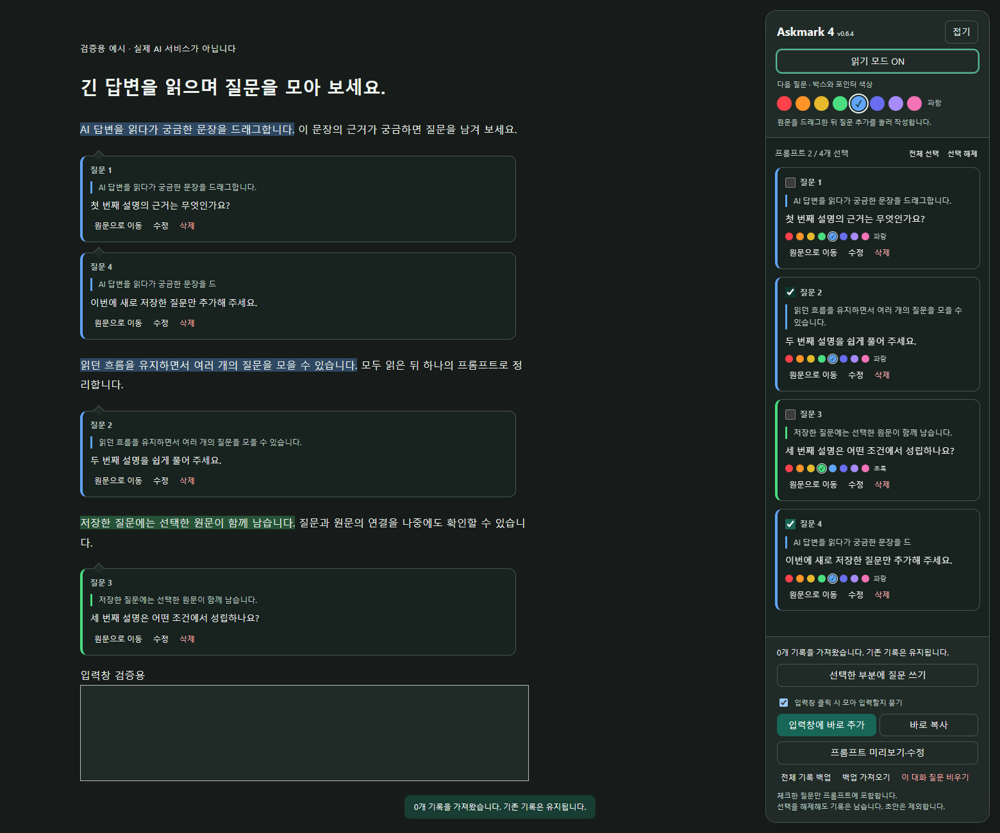
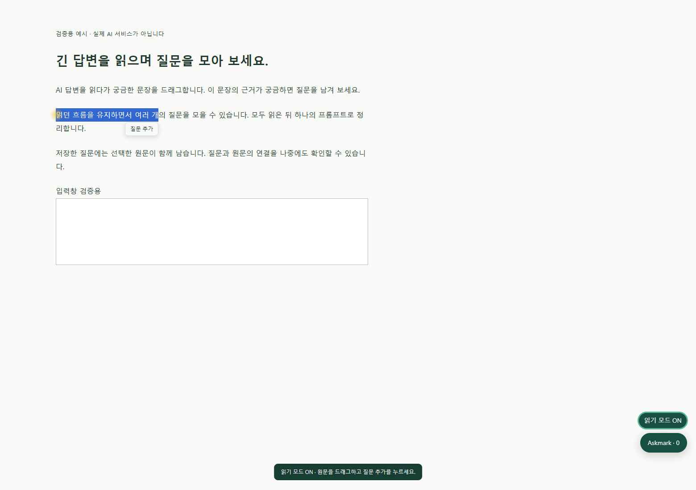
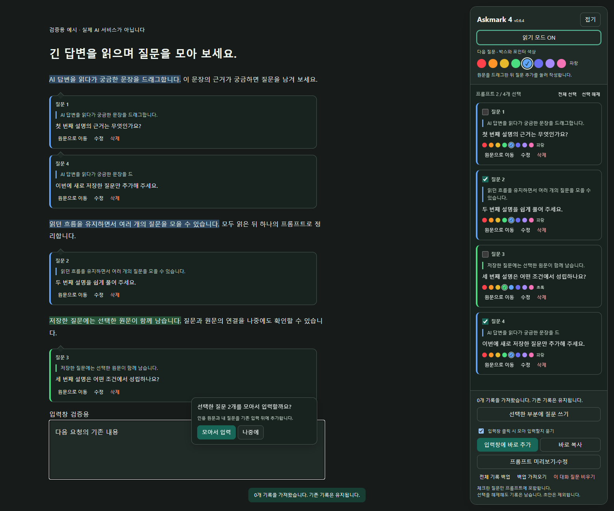

# Askmark

**Read. Mark. Ask again.**

Read a long ChatGPT answer, select a passage, and click **질문 추가** (Add question) to write right beneath it. Keep reading, then collect your quotes and questions into one follow-up prompt.

[한국어 안내](README.ko.md) · [Validation](docs/VALIDATION.md)



*Screenshot: the actual extension on a synthetic test page, not a live ChatGPT conversation. The interface is currently in Korean.*

## What it does

- Reading mode with a soft pointer glow and persistent source highlights.
- Selecting text shows a small **Add question** button. It does not open an editor, steal focus, or create a draft until you click it.
- Inline question bubbles and a synchronized right-hand list.
- Compact 12px color dots in each question card, with a selection ring, checkmark and color-name tooltip.
- Eight colors selected from the right panel; the pointer follows the active question color.
- Exact quote/question pairing, editing, deletion, and local backup/import.
- A checkbox before each question title chooses whether to include it in the next prompt. Select or deselect all in one click. Unchecking keeps the record and annotations.
- An editable follow-up prompt containing only checked questions; copy it or append it to ChatGPT's existing input.
- Optional confirmation beside your pointer when clicking ChatGPT's input. Confirm to append checked pairs with duplicate protection. Askmark never submits the message.
- No AI API key, server, or separate account.

## Supported sites

| Site | Status |
| --- | --- |
| ChatGPT (`chatgpt.com`) | Dedicated integration implemented; fixture-tested. Live installed-build verification remains outstanding. |
| Claude, Gemini, Perplexity, other AI sites | Not supported or verified as dedicated integrations yet. |
| Other ordinary web pages | Experimental toolbar-triggered injection exists. Do not assume reliable anchoring or AI-composer integration. |

The current composer integration specifically targets ChatGPT. Other providers need their own answer recognition, conversation identity, source restoration, and input adapter. Multi-provider support is a future direction, not an existing feature.

## Install

[Install ZIP](releases/askmark-v0.6.4.zip) · [Complete source ZIP](releases/askmark-v0.6.4-source.zip)

1. Download and extract [Askmark v0.6.4](releases/askmark-v0.6.4.zip), or download this repository.
2. Open `chrome://extensions` and enable Developer mode.
3. Choose **Load unpacked** and select the directory containing `manifest.json`.
4. Refresh the ChatGPT tab. Open Askmark and enable reading mode.

### Update from Question Basket

Keep the existing installation directory and extension installed. Back up your notes, then replace `manifest.json`, `content.js`, and `background.js` in that same directory. Reload the extension **and** refresh the ChatGPT tab. Confirm v0.6.4 in the panel. Existing `qb:note:` records and backup format are preserved.

## Use

1. Enable reading mode and drag over an answer passage. Continue reading freely, or click the small **질문 추가** button.
2. After clicking Add question, type in the bubble beneath the passage and save. Repeat while reading.
3. Check only the questions you want in the next prompt. Save or cancel unfinished drafts, then click the ChatGPT input. Choose **모아서 입력** in the confirmation beside your pointer, or use the right-hand append/copy buttons.
4. Review the prompt and send it yourself.

Turning reading mode off hides source annotations, not saved records. Unsaved drafts survive mode changes in the current tab but not a reload or tab close. If exact source identity cannot be confirmed, the note stays in the right-hand list without being attached to another sentence.

The selection button follows the passage during scrolling. Clicking elsewhere, pressing Esc, clearing the selection, or turning reading mode off dismisses it without changing saved questions or typed drafts. Selecting another passage replaces the pending selection only.



Question checkboxes control prompt membership, independently of the active color/editor. New and older questions start checked; choices persist locally across refreshes and are included in backups. Uncheck old questions before the next prompt, or use **선택 해제** (Deselect all). Recheck a question to reuse it. The selection diagnostic copy button has been removed from the interface.

The right-hand **입력창 클릭 시 모아 입력할지 묻기** checkbox controls the click confirmation independently of reading mode. Clearing the input allows you to add the checked pairs again after confirmation. Pairs already present in the current input are skipped. Both the legacy `#prompt-textarea` and current ID-less `data-composer-markdown` editor are recognized. A paragraph in a horizontal/grid layout keeps its question bubble below its text, rather than in another layout column.



The generated prompt contains numbered quotes and your questions. The old instruction to ignore instructions inside quotes has been removed; the source quote and your question remain verbatim.

## Privacy

Notes are stored in `chrome.storage.local`. Askmark does not make network requests. Text is placed in the site's composer only through the described user actions; the user controls submission. Exported backups contain your selected quotes and questions, so keep them private.

## Development

The extension is plain JavaScript and needs no build step. Tests use Node.js and Playwright:

```sh
npm install
```

Set `QA_BROWSER` to an extension-capable Chromium executable, then:

```sh
npm test
```

Tests use isolated browser profiles and synthetic HTML routed under a ChatGPT URL. Two suites use mocked storage for failure injection. They do not prove compatibility with a live account's current ChatGPT renderer. See [validation details](docs/VALIDATION.md).

To produce the install ZIP with Python 3:

```sh
python scripts/package.py
```

## Release 0.6.4

Added **[ ] 질문 N** checkboxes for prompt inclusion, with select/deselect all and locally persisted choices. Preview, copy, manual append, and input-click confirmation all use only checked questions. Unchecking never deletes notes or annotations. Removed the selection diagnostic copy UI; stored-note format and permissions remain unchanged.

## Project status

Early release. ChatGPT DOM changes can require compatibility fixes. This project is not affiliated with OpenAI.
